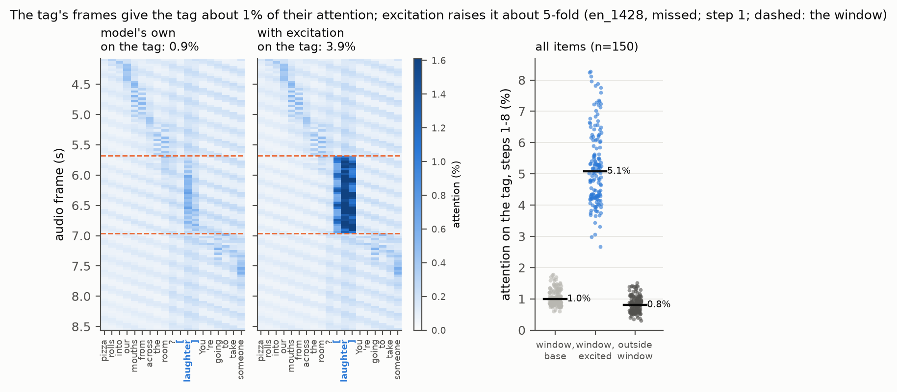

# Attention excitation for NVV tags: motivation and evidence

Why we raise the attention from the speech around a tag to the tag's text tokens, and what in our models and data
supports each step of the argument. Numbers are from NVV-SuperBench (English, tag-based), judge
`qwen3.8-omni-flash`, one run, seed 0, excitation b = 2 (`e2`), unless stated.

The argument has three steps:

1. A tag gets a small share of attention and loses to the words around it; raising that share makes the model
   voice it.
2. Whether the tag is voiced is settled when the frames around it are committed, so the boost has to come before.
3. One tag is a few text tokens but its sound spans many audio frames, so the boost acts from a window of frames
   where the sound belongs, which also supplies the location Attend-and-Excite says a plain attention boost lacks.

## 1. The tag gets little attention, and raising it voices the tag

**Motivation (Attend-and-Excite).** Chefer et al. trace "catastrophic neglect" (a prompt subject that is not
generated) to a token that gets too little cross-attention: "if [its attention does] not reach a certain value in
the early denoising stages, the corresponding object will not be generated." They raise it and the subject appears.
A missed tag is the same failure in TTS: the text asks for a sound and the model reads straight through.

**The tag's share is small.** In base OmniVoice, during the first 8 steps, a frame in the tag's window puts a median
of **1.0%** of its attention (mean over heads and layers) on the tag's tokens, against 0.8% for frames outside the
window. In CosyVoice 2 the current speech token puts **0.7%** on the tag while the model reads it. The rest goes to
the voice prompt, the other words and the speech so far.

Where each audio frame looks, on a missed item (en_1428, a laugh) at the first step (`results/figs/fig_attention.png`;
rows are audio frames, columns the text tokens around the tag, dashed lines the window):



The diagonal is the text-to-speech alignment: each frame reads the word it is saying. In the window the alignment does
reach the tag (its column is the brightest text in those rows), so the model finds the tag, but faintly. Of the window
frames' attention, 69% goes to the speech being made, 11% to the voice prompt and 6% to the whole text; the tag's
three tokens get 0.9%. With excitation the tag's column in the window becomes the darkest part of the grid, and the
rows outside the window are unchanged. Across all 150 items the frames where
the tag's sound belongs give it 1.0%, hardly more than the other frames (0.8%). Excitation raises it to 3.9% on this
frame and to a median of 5.1% over the items, and leaves the rest of the text as it was.

**Excitation raises it as intended, and only it.** Adding b = 2 to the scores multiplies the odds of attending to
the tag by e^2 ≈ 7.4. Measured on the audio that was judged (all 150 OmniVoice and 400 CosyVoice 2 traces reproduce
the judged clips exactly):

| | Tag share, natural | Tag share, excited | Ratio |
|---|---|---|---|
| OmniVoice, window frames, steps 1-8 | 1.01% | 5.08% | ×5.0 |
| CosyVoice 2, steps at the tag | 0.7% | 2.9% | ×4.0 |

The model's own (pre-bias) attention is unchanged by excitation (OmniVoice 1.01% with and without it), and after
step 8 it is back to the base level (1.12% vs 1.11%): the bias does not change how the model attends on its own,
only what the excited steps read.

**Raising it voices the tag.** Excitation alone fixes misses on both models:

| Model | F1, no guidance | F1, e2 | Fixed / broken | p (sign test) |
|---|---|---|---|---|
| OmniVoice (150 items) | 0.909 | 0.970 | 12 / 1 | .003 |
| CosyVoice 2 (400 items) | 0.551 | 0.603 | 61 / 38 | .027 |

**The gain needs the tag's tokens (placebo, OmniVoice).** The same bias, in the same window and steps, on another
word's tokens instead of the tag's:

| Setting | F1 | Fixed / broken vs no guidance | e2 better / worse |
|---|---|---|---|
| e2 (tag's tokens) | 0.970 | 12 / 1 | |
| word before the tag | 0.916 | 8 / 8 | 13 / 2, p = .007 |
| sentence's first word | 0.926 | 6 / 4 | 11 / 2, p = .022 |
| no guidance, seed 1 | 0.943 | 11 / 5 | 6 / 1, p = .125 |

Biasing attention in the window is not enough by itself; it has to go to the tag.

## 2. The tag is settled when its frames are committed

**Motivation (Attend-and-Excite).** Chefer et al. stop optimizing after the early steps because "the final
timesteps do not alter the spatial locations of objects": once the layout is set, a boost cannot put a missing
object back.

**OmniVoice commits late.** Its unmasking schedule (32 steps, t_shift 0.1) commits few frames early: 3% by step 8,
9% by step 16, 23% by step 24, 41% by step 28, 60% by step 30. So "early" has to be measured in committed frames,
not in steps.

**Moving the same excitation later (OmniVoice):**

| Excitation in steps | Frames committed at start | Steps excited | F1 | Fixed / broken | e2 better / worse |
|---|---|---|---|---|---|
| 1-8 (e2) | 0% | 8 | 0.970 | 12 / 1 | |
| 9-32 | 3% | 24 | 0.973 | 10 / 0 | 3 / 2, p = 1 |
| 1-32 | 0% | 32 | 0.970 | 13 / 2 | 1 / 1 |
| 25-32 | 23% | 8 | 0.933 | 5 / 1 | 8 / 1, p = .039 |
| 29-32 | 41% | 4 | 0.919 | 3 / 3 | 12 / 1, p = .003 |

While almost every frame is still open (steps 1-8 or 9-32), the gain is the same. Starting at step 25, with the
same 8 excited steps as e2 but a quarter of the frames already committed, most of it is gone; by step 29 none is
left. Once the frames around the tag are filled with speech, attending to the tag can no longer put the sound in.

**CosyVoice 2.** An autoregressive model commits each speech token as it emits it, so the speech at the tag is
decided exactly once, when the model reaches the tag. The bias therefore acts at those steps (read from the model,
see 3), not in a fixed first-K range.

## 3. A window of frames, because one tag spans many frames

**One-to-many.** A tag is 3-7 text tokens in OmniVoice's tokenizer (`[laughter]` 3, `[sigh]` 4, `[surprise-ah]` and
`[surprise-oh]` 6, `[dissatisfaction-hnn]` 7), but its sound lasts many frames at 25 frames/s. Excitation therefore
acts from every frame where the sound may fall: from the start of the word before the tag to the end of the word
after it, widened by 0.3 s for the error of the duration estimate. Over the 150 items the window is a median of 30
frames (1.2 s; range 16-124) out of a median utterance of 168 frames.

**It supplies the location (Attend-and-Excite's objection).** Chefer et al. argue that rescaling a neglected token's
attention, as Prompt-to-Prompt does, cannot help: an absent object "is not allocated a spatial location", so
amplifying it "will have no effect", and they optimize the latent instead. For a tag the location is known before
generation: the window says where the sound belongs, and the bias acts only from those frames, as eDiff-I's
paint-with-words and DenseDiffusion add a bias inside a user-drawn region. This is what lets a constant bias, with
no gradient and no extra pass, do the job.

**Where the window comes from.**

- OmniVoice: its own rule-based duration estimate of the text up to each word boundary, scaled to the target length.
- CosyVoice 2: the output length is open, so the window is read from the model. In LM layers 11 and 16 the
  attention peak over the text moves monotonically with the step (Spearman ρ 0.99-1.00 against the step on 4 items, against 0.08-0.45 for the mean over all
  layers; `results/read_position_check.md`); the window is
  on while the peak is within the word before the tag to the word after it (±1 token). It is on for 25-28% of the
  decoding steps.

## Reproducing

Every number above is recomputed by `evidence.py` from saved outputs, without synthesis or judge calls. The judged
predictions and the attention traces of the reported runs are in `results/`:

```bash
python -m bench.excite.evidence --out results     # -> results/excite_evidence.md (needs torch; transformers for tag token counts)
```

To regenerate the inputs (GPU; see the top README for environments):

| Evidence | Command | Output |
|---|---|---|
| e2 and no-guidance audio, F1 | `python -m bench.run_omnivoice --out out`, `python -m bench.run_cosyvoice --out out`, `python -m bench.score --out out` | `out/<system>/`, `out/nvv_pred/` |
| Attention shares | `python -m bench.excite.attn_omnivoice --out out`, `python -m bench.excite.attn_cosyvoice --out out` | `out/attn/*.pt` |
| Placebo, reseed, later steps | `python -m bench.excite.control_omnivoice --out out`, then `python -m bench.score --out out` | `out/omnivoice_<setting>/` |
| Read-position layers (section 3) | `python -m bench.excite.read_position_check --items 4` | `out/read_position_check.md` |
| Per-outcome attention, per layer | `python -m bench.excite.attn_report --out out` | `out/attn/attn_report.md` |

The attention grid of section 1 (`results/figs/fig_attention.png`): `python -m bench.excite.probe_attn_omnivoice --out out --ids en_1428`, then `python -m bench.excite.figures --out out`.

The excitation code is `src/tagguide/excite.py`; the model adapters (`omnivoice.py`, `cosyvoice.py`) apply it.

## References

- Chefer et al., Attend-and-Excite, SIGGRAPH 2023 ([arXiv 2301.13826](https://arxiv.org/abs/2301.13826))
- Hertz et al., Prompt-to-Prompt, ICLR 2023 ([arXiv 2208.01626](https://arxiv.org/abs/2208.01626))
- Balaji et al., eDiff-I (paint-with-words), 2022 ([arXiv 2211.01324](https://arxiv.org/abs/2211.01324))
- Kim et al., DenseDiffusion, ICCV 2023 ([arXiv 2308.12964](https://arxiv.org/abs/2308.12964))
